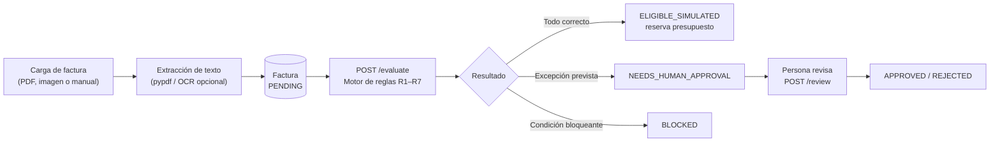

# fgaBlinka30x — Agente inteligente para gestión de facturas

> Prototipo web que recibe facturas, las compara con las reglas de pago de una empresa ficticia y emite una **decisión explicada**: apta para pago (simulado), frenada o con necesidad de aprobación humana.
>
> **Datos 100 % ficticios. El sistema no ejecuta pagos reales.** Una prueba automática verifica que la API no expone ninguna ruta de pago.

| | |
|---|---|
| **Empresa de demostración** | Orquídea Andina S.A.S. (ficticia) · moneda base USD |
| **Backend** | Python 3.12 · FastAPI · SQLAlchemy 2 · Alembic · PostgreSQL 15 |
| **Frontend** | React 18 · TypeScript · Vite 6 (la interfaz muestra la marca *TrustFlow*) |
| **Despliegue** | Docker Compose (PostgreSQL + API + nginx con el frontend compilado) |
| **Pruebas** | Suite automatizada con pytest |
| **Licencia** | GNU GPL v3 (ver [`LICENSE`](LICENSE)) |

## Contenido

1. [¿Qué hace?](#qué-hace)
2. [Funcionalidades](#funcionalidades)
3. [Inicio rápido](#inicio-rápido)
4. [Documentación](#documentación)
5. [Estructura del repositorio](#estructura-del-repositorio)
6. [Pruebas y demostración](#pruebas-y-demostración)
7. [Estado del proyecto y limitaciones conocidas](#estado-del-proyecto-y-limitaciones-conocidas)
8. [Solución rápida de problemas](#solución-rápida-de-problemas)
9. [Licencia](#licencia)

---

## ¿Qué hace?

Cada factura recorre este flujo:



El motor es **determinista** (sin IA generativa): aplica siete reglas en orden, acumula **todos** los motivos y resuelve con esta jerarquía de seguridad: `BLOCKED` > `NEEDS_HUMAN_APPROVAL` > `ELIGIBLE_SIMULATED`.

### Estados de una factura

| Estado | Etiqueta en la interfaz | Significado |
|---|---|---|
| `PENDING` | Pendiente | Cargada, todavía sin evaluar |
| `ELIGIBLE_SIMULATED` | Apta para pago simulado | Pasó todas las reglas; reserva presupuesto |
| `NEEDS_HUMAN_APPROVAL` | Requiere aprobación | Excepción prevista por la política; requiere una persona |
| `BLOCKED` | Frenada | Condición que impide continuar |
| `APPROVED` / `REJECTED` | Aprobada / Rechazada | Resolución de una persona sobre una factura que requería aprobación |

Las reglas y los 26 casos de prueba están descritos en [`docs/catalogo-reglas.md`](docs/catalogo-reglas.md).

## Funcionalidades

- **Políticas de pago versionadas.** Cada edición crea una versión nueva (`v1`, `v2`…) con su motivo de cambio; las decisiones anteriores conservan la versión con la que se tomaron. Para cada motivo de la política se configura si frena o escala a una persona.
- **Motor de reglas R1–R7:** datos mínimos, duplicados, beneficiario, acuerdo, máximo por factura, presupuesto del periodo y umbral de aprobación humana.
- **Ingesta de documentos.** Subida de PDF o imagen (máx. 10 MB), hash SHA-256 para detectar duplicados exactos y extracción de texto con `pypdf`; OCR con Tesseract opcional.
- **Historial de decisiones inmutable.** Reevaluar una factura añade un registro nuevo; nunca sobrescribe el anterior.
- **Sin inicio de sesión.** La aplicación de demostración abre directamente y permite usar sus funciones sin autenticarse.
- **Auditoría visible.** Historial de actividad con fecha, acción, cambios y justificación; las acciones se atribuyen a «Usuario de demostración» porque no hay autenticación.
- **Control de presupuesto** por periodo mediante reservas.
- **Centro de aprobaciones** con justificación obligatoria al aprobar o rechazar.
- **Numeración interna secuencial** de facturas (`A000`–`A999`, `B000`… hasta `Z999`).
- **Interfaz web** con panel, facturas, carga, aprobaciones, historial, reglas y políticas, y beneficiarios; tema claro/oscuro y barra lateral plegable.
- **Acceso desde otros dispositivos** de la misma red (ver la [guía de desarrollo](docs/GUIA_DESARROLLO.md#6-acceso-desde-otros-dispositivos)).

## Inicio rápido

Requisitos: **Docker** con Docker Compose v2 y **Git**.

```bash
git clone https://github.com/juanesteban-cj7/fgaBlinka30x.git
cd fgaBlinka30x
docker compose up -d --build
docker compose ps          # el backend debe aparecer como "healthy"
```

Compose levanta PostgreSQL, aplica las migraciones, carga los datos ficticios (solo si aún no existen) e inicia la API y el frontend de producción.

| Servicio | URL | Para qué |
|---|---|---|
| Aplicación web | <http://localhost:8080> | Interfaz completa; nginx reenvía `/api` al backend |
| API (Swagger) | <http://localhost:8000/docs> | Documentación interactiva de la API |
| Salud de la API | <http://localhost:8000/health> | Debe responder `{"status":"ok"}` |
| PostgreSQL | `localhost:5432` | Usuario `postgres`, contraseña `postgres`, base `facturas_demo` (solo desarrollo) |

La aplicación no solicita credenciales. Es una demo sin autenticación y no debe exponerse como servicio público ni utilizarse con datos sensibles.

Para detener todo: `docker compose down` (agrega `-v` para borrar también los datos de la base).

Otras formas de ejecutar el proyecto (backend sin Docker, frontend con recarga en caliente, migraciones, variables de entorno) están en la [guía de desarrollo](docs/GUIA_DESARROLLO.md).

## Documentación

| Documento | Contenido |
|---|---|
| [`docs/ARQUITECTURA.md`](docs/ARQUITECTURA.md) | Diagramas, capas del backend, motor de reglas, modelo de datos, frontend, despliegue y decisiones de diseño |
| [`docs/API.md`](docs/API.md) | Referencia de todos los endpoints con ejemplos `curl` y respuestas reales |
| [`docs/GUIA_DESARROLLO.md`](docs/GUIA_DESARROLLO.md) | Entornos, variables, migraciones, pruebas, OCR, cómo extender el sistema y solución de problemas |
| [`docs/ESTRUCTURA.md`](docs/ESTRUCTURA.md) | Qué hace cada carpeta y cada archivo |
| [`docs/catalogo-reglas.md`](docs/catalogo-reglas.md) | Catálogo de reglas, política v1, datos demo y dataset de 26 facturas |

## Estructura del repositorio

```text
fgaBlinka30x/
├── backend/            API FastAPI: modelos, esquemas, motor de reglas, servicios y pruebas
├── frontend/           Aplicación React + TypeScript + Vite (y su configuración de nginx)
├── data-demo/          Datos ficticios: configuración, dataset de 26 facturas y archivos subidos
├── migrations/         Migraciones de Alembic (versiones 0001–0006)
├── docs/               Documentación
├── docker-compose.yml  PostgreSQL + backend + frontend
├── alembic.ini         Configuración de Alembic
├── demo_phase6.sh      Demostración repetible de la Fase 6
└── LICENSE
```

El detalle archivo por archivo está en [`docs/ESTRUCTURA.md`](docs/ESTRUCTURA.md).

## Pruebas y demostración

```bash
cd backend
pip install -r requirements.txt
pytest -q                  # Usa SQLite (backend/test.db), no necesita PostgreSQL
```

| Archivo de prueba | Qué cubre |
|---|---|
| `test_auth.py` | Acceso sin login y ausencia de rutas de autenticación |
| `test_audit_log.py` | Snapshot del actor, filtros, paginación y API append-only |
| `test_crud.py` | Beneficiarios, políticas, facturas, diffs de auditoría y atomicidad |
| `test_evaluate.py` | Evaluación, decisiones y reserva de presupuesto |
| `test_rules.py` | Motor contra el dataset de 26 facturas |
| `test_upload.py` | Subida de archivos y re-extracción |
| `test_invoice_numbering.py` | Numeración `A000`–`Z999` |
| `test_dashboard.py` | Resumen del panel |
| `test_phase6.py` | Dataset, presupuesto, reevaluación y controles de seguridad |

Otras verificaciones:

```bash
python3 -I data-demo/verify_expected.py   # consistencia del dataset (26/26, esperado: TODO CONSISTENTE)
./demo_phase6.sh                          # demostración repetible de la Fase 6 (requiere python3 y pytest)
```

## Estado del proyecto y limitaciones conocidas

Las fases 0 a 6 están implementadas: identidad autenticada, CRUD, motor de reglas, ingesta de documentos, auditoría e historial web.

Es un prototipo de demostración. Estas son las limitaciones que conviene conocer (detalle en [`docs/ARQUITECTURA.md`](docs/ARQUITECTURA.md#13-limitaciones-conocidas-y-deuda-técnica)):

| Limitación | Efecto |
|---|---|
| La interfaz no llama a `/evaluate` | Las facturas cargadas desde la web quedan en `PENDING`; la evaluación se dispara por API (`POST /api/v1/invoices/{id}/evaluate`) |
| El motor lee `invoice.extracted` y ninguna ruta lo rellena | Evaluar una factura creada desde la web o por `/upload` produce `MISSING_REQUIRED_FIELDS`; las pruebas cargan ese campo directamente |
| Aprobar una factura no reserva presupuesto | `/review` solo cambia el estado y guarda la revisión, aunque el catálogo de reglas indica que debería reservar |
| Sin OCR en la imagen Docker | Las imágenes y los PDF escaneados requieren instalar Tesseract (ver guía) |
| El periodo de presupuesto es siempre mensual | `period_type` admite `quarterly` y `yearly`, pero el motor agrupa por `YYYY-MM` |
| Esquema parcialmente fuera de Alembic | `policy_rule_action` y `policy_change_reason` se crean con `create_all`, no con migraciones |
| Higiene del repositorio | Hay `node_modules/`, `dist/`, `.pyc` y `backend/test.db` versionados y no existe `.gitignore` |

## Solución rápida de problemas

| Síntoma | Causa probable y solución |
|---|---|
| `alembic ... Path doesn't exist: .../backend/migrations` | Alembic se ejecutó desde `backend/`. Ejecútalo desde la raíz (`alembic upgrade head`) o usa `python -m app.services.migrate` |
| La web muestra «No se pudo conectar con la API» | El backend no está activo o falta el proxy `/api`. Revisa `docker compose ps` y `docker compose logs backend` |
| `GET /api/v1/policy` responde 404 «No hay política activa» | La base no tiene datos. Ejecuta el seed (`python -m app.services.seed`) o reinicia con `docker compose up -d` |
| El puerto 5432, 8000 u 8080 está ocupado | Cierra el proceso que lo usa o cambia el mapeo de puertos en `docker-compose.yml` |
| `npm run dev` falla en Linux o macOS con errores de `esbuild` | La carpeta `node_modules` versionada incluye binarios de otro sistema: bórrala y ejecuta `npm install` |

Más casos en la [guía de desarrollo](docs/GUIA_DESARROLLO.md#11-solución-de-problemas).

## Licencia

Este proyecto se distribuye bajo la **GNU General Public License v3.0**. Consulta el archivo [`LICENSE`](LICENSE).
```text
fgaBlinka30x/
├── backend/              # API FastAPI (Fases 2-4)
│   ├── Dockerfile
│   ├── requirements.txt
│   ├── app/
│   │   ├── main.py              # App FastAPI + /health
│   │   ├── database.py          # SQLAlchemy engine, sesión y Base
│   │   ├── api/
│   │   │   ├── deps.py
│   │   │   └── v1/
│   │   │       ├── router.py
│   │   │       ├── policy.py            # CRUD y activación de políticas
│   │   │       ├── beneficiaries.py     # CRUD de beneficiarios
│   │   │       ├── invoices.py          # CRUD de facturas
│   │   │       ├── evaluate.py          # /evaluate y /decisions (Fase 3)
│   │   │       └── upload.py            # /upload y /extract (Fase 4)
│   │   ├── models/              # Modelos SQLAlchemy (todas las entidades)
│   │   ├── schemas/             # Esquemas Pydantic
│   │   ├── rules/               # Motor determinista de reglas (Fase 3)
│   │   ├── services/
│   │   │   ├── seed.py          # Carga de datos ficticios (Fase 1)
│   │   │   ├── evaluation.py    # Motor + persistir decisión y reserva (Fase 3)
│   │   │   ├── extraction.py    # Extracción de texto de PDF/imagen (Fase 4)
│   │   │   └── ocr.py           # OCR con Tesseract (opcional, Fase 4)
│   │   └── tests/
│   │       ├── conftest.py
│   │       ├── test_crud.py
│   │       ├── test_evaluate.py
│   │       ├── test_rules.py
│   │       └── test_upload.py
├── frontend/             # Interfaz web React + TypeScript + Vite (Fase 5)
│   ├── package.json
│   ├── vite.config.ts
│   ├── tsconfig.json
│   ├── index.html
│   ├── src/
│   │   ├── main.tsx
│   │   ├── App.tsx              # Enrutamiento React Router
│   │   ├── index.css            # Estilos (Tailwind-like)
│   │   ├── lib/utils.ts         # Formateo y helpers de UI
│   │   ├── types/index.ts       # Tipos compartidos con la API
│   │   ├── services/api.ts      # Cliente de la API (fetch)
│   │   ├── components/Layout.tsx
│   │   ├── pages/
│   │   │   ├── Dashboard.tsx
│   │   │   ├── Invoices.tsx
│   │   │   ├── InvoiceDetail.tsx
│   │   │   ├── Upload.tsx
│   │   │   ├── ApprovalCenter.tsx
│   │   │   ├── History.tsx
│   │   │   ├── Rules.tsx
│   │   │   └── Beneficiaries.tsx
│   └── dist/                    # Build de producción
├── data-demo/                 # Dataset y reglas de la Fase 1
│   ├── demo-config.json
│   ├── expected-results.json
│   ├── invoices/
│   │   └── invoices.json
│   ├── uploads/               # Archivos subidos (Fase 4, se crea al usar)
│   └── verify_expected.py
├── docs/
│   └── catalogo-reglas.md     # Catálogo de reglas y resultados esperados (Fase 1)
├── migrations/                # Migraciones de Alembic (PostgreSQL)
│   ├── env.py
│   ├── script.py.mako
│   └── versions/
│       ├── 0001_initial_schema.py
│       ├── 0002_add_extracted_to_invoice.py
│       └── 0003_add_file_path_to_invoice.py
├── alembic.ini
├── docker-compose.yml         # PostgreSQL + backend
├── LICENSE
└── README.md
```

# Referencia de la API

API REST del backend (FastAPI). Los ejemplos de respuesta se obtuvieron ejecutando la aplicación con datos de prueba.

- **Documentación interactiva (Swagger):** <http://localhost:8000/docs>
- **Esquema OpenAPI:** <http://localhost:8000/openapi.json>

## Contenido

1. [Convenciones](#1-convenciones)
2. [Índice de endpoints](#2-índice-de-endpoints)
3. [Salud](#3-salud)
4. [Panel](#4-panel)
5. [Políticas](#5-políticas)
6. [Beneficiarios](#6-beneficiarios)
7. [Facturas](#7-facturas)
8. [Evaluación y decisiones](#8-evaluación-y-decisiones)
9. [Revisión humana](#9-revisión-humana)
10. [Errores](#10-errores)

---

## 1. Convenciones

| Tema | Detalle |
|---|---|
| URL base | `http://localhost:8000/api/v1` (directa) o `http://localhost:8080/api/v1` (a través de nginx) |
| Formato | JSON (`Content-Type: application/json`), salvo la subida de archivos, que usa `multipart/form-data` |
| Autenticación | **Ninguna.** Es un prototipo con datos ficticios |
| Barra final | `/policy`, `/beneficiaries` y `/invoices` responden con una redirección 307 hacia la versión con barra final. En `curl` usa la barra (`/invoices/`) o la opción `-L` |
| Decimales | Los importes se devuelven como **cadenas** (`"500"`, `"5000"`); se aceptan como número o como cadena |
| Fechas | `YYYY-MM-DD` para fechas; marcas de tiempo ISO 8601 sin zona horaria en `created_at` |
| Identificadores | Cadenas. En `POST /beneficiaries` y `POST /invoices` el cliente envía el `id` |
| Errores | `{"detail": "mensaje"}`; los errores de validación (422) devuelven una lista en `detail` |

Todos los ejemplos usan `$API` como atajo:

```bash
API=http://localhost:8000/api/v1
```

## 2. Índice de endpoints

| Método | Ruta | Descripción |
|---|---|---|
| GET | `/health` | Estado del servicio (fuera de `/api/v1`) |
| GET | `/dashboard/summary` | Totales del panel |
| GET | `/policy/catalog` | Catálogo de motivos configurables |
| GET | `/policy/versions` | Todas las versiones de política |
| GET | `/policy/` | Política activa |
| PUT | `/policy/` | Crear una versión nueva de política |
| POST | `/policy/activate` | Activar una versión |
| PATCH | `/policy/budget` | Cambiar el presupuesto de la política activa |
| GET | `/beneficiaries/` | Listar beneficiarios |
| POST | `/beneficiaries/` | Crear un beneficiario |
| GET | `/invoices/` | Listar facturas con filtros |
| POST | `/invoices/` | Crear una factura (entrada manual) |
| GET | `/invoices/{id}` | Obtener una factura |
| PATCH | `/invoices/{id}` | Actualizar una factura |
| POST | `/invoices/upload` | Subir un PDF o imagen y crear la factura |
| POST | `/invoices/{id}/extract` | Repetir la extracción de texto |
| POST | `/invoices/{id}/evaluate` | Evaluar con el motor de reglas |
| GET | `/invoices/{id}/decisions` | Historial de decisiones de la factura |
| POST | `/invoices/{id}/review` | Aprobar o rechazar una factura que requiere aprobación |

## 3. Salud

### `GET /health`

```bash
curl http://localhost:8000/health
```

```json
{"status": "ok"}
```

## 4. Panel

### `GET /dashboard/summary`

Parámetro opcional: `company_id`.

```bash
curl "$API/dashboard/summary"
```

```json
{
  "total": 0,
  "ELIGIBLE_SIMULATED": 0,
  "BLOCKED": 0,
  "NEEDS_HUMAN_APPROVAL": 0,
  "PENDING": 0,
  "budget_consumed": 0.0,
  "budget_total": 12000.0
}
```

- `total` cuenta todas las facturas (incluidas `APPROVED` y `REJECTED`).
- `budget_consumed` es la **suma del importe de todas las facturas** registradas, no el saldo de reservas.
- `budget_total` es el presupuesto de las políticas activas.

## 5. Políticas

### `GET /policy/catalog`

Devuelve la lista de los 14 motivos configurables. Cada elemento tiene `code`, `rule`, `label`, `description`, `allowed_actions` y `default_action`.

### `GET /policy/versions`

Lista de todas las versiones, de la más reciente a la más antigua. Cada elemento tiene el formato de la política activa.

### `GET /policy/`

Política activa. Responde `404` con `{"detail": "No hay política activa"}` si no existe.

```json
{
  "version": 1,
  "active": true,
  "currency": "USD",
  "max_invoice_amount": "5000",
  "approval_threshold": "1000",
  "period_budget": "12000",
  "period_type": "monthly",
  "period_basis": "issue_date",
  "amount_tolerance_pct": "0",
  "min_extraction_confidence": 0.8,
  "name_similarity_threshold": 0.85,
  "possible_duplicate_date_window_days": 0,
  "rule_actions": [
    {"code": "DUPLICATE_CONFIRMED", "action": "BLOCKED"},
    {"code": "POSSIBLE_DUPLICATE", "action": "NEEDS_HUMAN_APPROVAL"}
  ],
  "id": "pol_v1",
  "company_id": "co_demo_001",
  "created_at": "2026-10-18T16:06:03"
}
```

(`rule_actions` completa tiene 14 elementos; se abrevió aquí.)

### `PUT /policy/` — crear una versión nueva

Crea la versión `N+1`; no modifica las anteriores.

| Campo | Tipo | Reglas |
|---|---|---|
| `company_id` | texto | Debe existir (404 si no) |
| `version` | entero ≥ 1 | Debe ser **exactamente** la última versión de la empresa + 1 (422: «La siguiente versión debe ser vN») |
| `currency` | texto | Tres letras mayúsculas (`USD`) |
| `max_invoice_amount` | decimal ≥ 0 | Máximo absoluto por factura |
| `approval_threshold` | decimal ≥ 0 | No puede superar `max_invoice_amount` |
| `period_budget` | decimal ≥ 0 | Presupuesto por periodo |
| `period_type` | `monthly`, `quarterly` o `yearly` | Ver limitaciones en [`ARQUITECTURA.md`](ARQUITECTURA.md#13-limitaciones-conocidas-y-deuda-técnica) |
| `period_basis` | `issue_date` | Único valor admitido |
| `amount_tolerance_pct` | decimal ≥ 0 | Por defecto 0 |
| `min_extraction_confidence` | 0 a 1 | Por defecto 0,80 |
| `name_similarity_threshold` | 0 a 1 | Por defecto 0,85 |
| `possible_duplicate_date_window_days` | entero ≥ 0 | Por defecto 0 |
| `rule_actions` | lista | **Exactamente** los 14 códigos del catálogo, sin repetir, con una acción permitida para cada uno |
| `change_reason` | texto 1–1000 | Obligatorio; no puede estar en blanco |
| `activate` | booleano | Por defecto `true`: la nueva versión queda activa y desactiva las demás |

```bash
curl -X PUT "$API/policy/" -H "Content-Type: application/json" -d '{
  "company_id": "co_demo_001",
  "version": 2,
  "currency": "USD",
  "max_invoice_amount": "5000",
  "approval_threshold": "2000",
  "period_budget": "12000",
  "period_type": "monthly",
  "period_basis": "issue_date",
  "change_reason": "Subir el umbral de aprobación humana a 2.000",
  "activate": true,
  "rule_actions": [
    {"code": "MISSING_REQUIRED_FIELDS", "action": "NEEDS_HUMAN_APPROVAL"},
    {"code": "INVALID_FIELD", "action": "NEEDS_HUMAN_APPROVAL"},
    {"code": "LOW_EXTRACTION_CONFIDENCE", "action": "NEEDS_HUMAN_APPROVAL"},
    {"code": "DUPLICATE_CONFIRMED", "action": "BLOCKED"},
    {"code": "POSSIBLE_DUPLICATE", "action": "NEEDS_HUMAN_APPROVAL"},
    {"code": "BENEFICIARY_NOT_ALLOWED", "action": "BLOCKED"},
    {"code": "BENEFICIARY_UNKNOWN", "action": "BLOCKED"},
    {"code": "BENEFICIARY_NAME_AMBIGUOUS", "action": "NEEDS_HUMAN_APPROVAL"},
    {"code": "CURRENCY_MISMATCH", "action": "NEEDS_HUMAN_APPROVAL"},
    {"code": "AGREEMENT_EXPIRED", "action": "NEEDS_HUMAN_APPROVAL"},
    {"code": "AGREEMENT_AMOUNT_MISMATCH", "action": "NEEDS_HUMAN_APPROVAL"},
    {"code": "ABOVE_MAX_INVOICE", "action": "BLOCKED"},
    {"code": "BUDGET_EXCEEDED", "action": "BLOCKED"},
    {"code": "ABOVE_APPROVAL_THRESHOLD", "action": "NEEDS_HUMAN_APPROVAL"}
  ]
}'
```

Respuesta: la política creada (mismo formato que `GET /policy/`), con `id` = `pol_{company_id}_v{version}`.

Error típico cuando `rule_actions` está incompleto:

```json
{"detail": [{"type": "value_error", "loc": ["body", "rule_actions"],
  "msg": "Value error, rule_actions debe incluir exactamente todos los códigos del catálogo"}]}
```

### `POST /policy/activate`

Activa una versión existente y desactiva las demás de su empresa.

```bash
curl -X POST "$API/policy/activate" -H "Content-Type: application/json" \
  -d '{"policy_id": "pol_v1"}'
```

```json
{"policy_id": "pol_v1", "active": true}
```

`404` si la política no existe.

### `PATCH /policy/budget`

Modifica `period_budget` de la política **activa en el lugar**, sin crear una versión nueva.

```bash
curl -X PATCH "$API/policy/budget" -H "Content-Type: application/json" \
  -d '{"period_budget": 15000}'
```

Errores: `422` «El presupuesto no puede ser negativo»; `404` si no hay política activa.

## 6. Beneficiarios

### `GET /beneficiaries/`

Parámetro opcional: `company_id`. Ordenados por nombre.

```json
[
  {
    "name": "Suministros Andinos Ltda",
    "normalized_name": "suministros andinos ltda",
    "allowed": true,
    "reference_code": null,
    "category": null,
    "id": "ben_001",
    "company_id": "co_demo_001"
  }
]
```

### `POST /beneficiaries/`

| Campo | Obligatorio | Descripción |
|---|---|---|
| `id` | Sí | Identificador único |
| `company_id` | Sí | Empresa a la que pertenece |
| `name` | Sí | Nombre del proveedor |
| `normalized_name` | Sí | Nombre normalizado (minúsculas, sin tildes ni puntos; ver [normalización](ARQUITECTURA.md#normalización)) |
| `allowed` | No | `true` por defecto; con `false` las facturas de este proveedor se frenan |
| `reference_code` | No | Código de referencia |
| `category` | No | Categoría |

Respuestas: `201` con el beneficiario; `400` «El beneficiario ya existe».

## 7. Facturas

### Estados

`PENDING`, `ELIGIBLE_SIMULATED`, `NEEDS_HUMAN_APPROVAL`, `BLOCKED`, `APPROVED`, `REJECTED`.

### `GET /invoices/`

Filtros opcionales: `company_id`, `status`, `beneficiary_id`. Orden: más recientes primero.

### `POST /invoices/` — entrada manual

Obligatorios: `id`, `company_id`, `source_type`. El resto es opcional: `beneficiary_id`, `invoice_number`, `amount`, `currency`, `issue_date`, `due_date`, `description`, `file_name`, `file_hash`, `file_path`, `extraction_confidence`, `raw_text` y `extracted`.

```bash
curl -X POST "$API/invoices/" -H "Content-Type: application/json" -d '{
  "id": "inv_demo1",
  "company_id": "co_demo_001",
  "source_type": "manual",
  "beneficiary_id": "ben_001",
  "invoice_number": "TC-1",
  "amount": "800.00",
  "currency": "USD",
  "issue_date": "2026-10-05",
  "extracted": {
    "beneficiary_name": "Suministros Andinos Ltda",
    "invoice_number": "TC-1",
    "amount": "800.00",
    "currency": "USD",
    "issue_date": "2026-10-05"
  }
}'
```

Respuesta `201` (la factura nace en `PENDING`):

```json
{
  "beneficiary_id": "ben_001", "invoice_number": "TC-1", "amount": "800",
  "currency": "USD", "issue_date": "2026-10-05", "due_date": null,
  "description": null, "source_type": "manual", "file_name": null,
  "file_hash": null, "file_path": null, "extraction_confidence": null,
  "raw_text": null,
  "extracted": {"beneficiary_name": "Suministros Andinos Ltda", "invoice_number": "TC-1",
                "amount": "800.00", "currency": "USD", "issue_date": "2026-10-05"},
  "id": "inv_demo1", "company_id": "co_demo_001",
  "status": "PENDING", "created_at": "2026-10-18T16:06:03"
}
```

`400` «La factura ya existe» si el `id` está repetido.

> **Importante:** el motor de reglas evalúa el campo JSON `extracted` (claves `beneficiary_name`, `invoice_number`, `amount`, `currency`, `issue_date`, `due_date`), no las columnas `amount`, `currency`, etc. Por eso el ejemplo anterior envía `extracted` en el `POST`. Hoy es la única vía para cargarlo: `PATCH /invoices/{id}` no lo admite y `/invoices/upload` lo deja en `null`.

### `GET /invoices/{id}`

`404` «Factura no encontrada» si no existe.

### `PATCH /invoices/{id}`

Actualización parcial. Campos admitidos: `status`, `beneficiary_id`, `invoice_number`, `amount`, `currency`, `issue_date`, `due_date`, `description` y `standardize_number`.

Con `"standardize_number": true` se asigna el siguiente número interno secuencial (`A000`–`Z999`):

```bash
curl -X PATCH "$API/invoices/inv_demo1" -H "Content-Type: application/json" \
  -d '{"standardize_number": true}'
```

`422` si se agotó la secuencia (`Z999`).

### `POST /invoices/upload` — subir un archivo

`multipart/form-data`:

| Campo | Obligatorio | Descripción |
|---|---|---|
| `file` | Sí | PDF o imagen: `.pdf`, `.png`, `.jpg`, `.jpeg`, `.tiff`, `.bmp`; máximo 10 MB |
| `beneficiary_id` | Uno de los dos | Asocia el proveedor y toma su empresa |
| `company_id` | Uno de los dos | Empresa, si no se indica proveedor |

```bash
curl -X POST "$API/invoices/upload" \
  -F "file=@factura.pdf" \
  -F "beneficiary_id=ben_001"
```

Respuesta `201`: la factura creada en `PENDING` con `file_name`, `file_hash` (`sha256:…`), `file_path`, `source_type` (`pdf` o `image`), `raw_text`, `extraction_confidence`, `ocr_available` y `ocr_warning`.

| Código | Causa |
|---|---|
| 400 | Extensión o tipo no permitido, archivo mayor de 10 MB, o el proveedor no pertenece a la empresa indicada |
| 404 | Proveedor o empresa no encontrados |
| 422 | No se indicó ni proveedor ni empresa («Seleccione un proveedor o indique una empresa») |

Solo se leen `file`, `beneficiary_id` y `company_id`; otros campos de formulario se ignoran. La factura creada no tiene importe, moneda ni fechas: se completan después con `PATCH`.

### `POST /invoices/{id}/extract`

Repite la extracción de texto sobre el archivo ya subido y actualiza `raw_text`, `extraction_confidence` y `source_type`.

```json
{
  "invoice_id": "inv_abc123", "source_type": "pdf",
  "raw_text": "…", "extraction_confidence": 0.95,
  "ocr_available": false, "ocr_warning": null
}
```

Errores: `404` si la factura no existe o el archivo ya no está en disco; `400` si la factura no tiene archivo asociado.

## 8. Evaluación y decisiones

### `POST /invoices/{id}/evaluate`

Aplica el motor de reglas con la política activa, actualiza el estado de la factura y **añade** un registro de decisión. Si la factura es apta, reserva presupuesto. No ejecuta ningún pago. Reevaluar es seguro: agrega un registro nuevo sin duplicar la factura ni la reserva.

```bash
curl -X POST "$API/invoices/inv_demo1/evaluate"
```

Ejemplo real con la factura creada arriba (cumple el acuerdo de 800,00 USD del proveedor):

```json
{
  "invoice_id": "inv_demo1",
  "outcome": "ELIGIBLE_SIMULATED",
  "reason_codes": ["ALL_CHECKS_PASSED"],
  "explanation": "La factura pasó todas las reglas y es apta para pago simulado. Importe evaluado: 800.00 USD.",
  "reserved_budget": true,
  "linked_invoice_id": null,
  "policy_version": 1,
  "rules_evaluated": ["R1", "R2", "R3", "R4", "R5", "R6", "R7"]
}
```

Si la misma factura se crea con las columnas rellenas pero **sin** `extracted`, el motor no ve los datos:

```json
{
  "invoice_id": "inv_demo1",
  "outcome": "NEEDS_HUMAN_APPROVAL",
  "reason_codes": ["MISSING_REQUIRED_FIELDS"],
  "explanation": "La factura requiere aprobación humana por una excepción prevista en la política. Motivos: Missing Required Fields",
  "reserved_budget": false,
  "linked_invoice_id": null,
  "policy_version": 1,
  "rules_evaluated": ["R1", "R2", "R3", "R4"]
}
```

| Campo | Significado |
|---|---|
| `outcome` | `ELIGIBLE_SIMULATED`, `NEEDS_HUMAN_APPROVAL` o `BLOCKED` |
| `reason_codes` | Todos los motivos detectados (`["ALL_CHECKS_PASSED"]` si no hubo ninguno) |
| `reserved_budget` | `true` si se reservó presupuesto |
| `linked_invoice_id` | Factura original cuando hay duplicado o posible duplicado |
| `policy_version` | Versión de la política aplicada |
| `rules_evaluated` | Reglas que se ejecutaron (las no evaluadas no aparecen) |

`404` si la factura no existe, y el identificador del registro creado se consulta luego en `GET /invoices/{id}/decisions`.

### `GET /invoices/{id}/decisions`

Todas las decisiones de la factura, de la más reciente a la más antigua.

```json
[
  {
    "invoice_id": "inv_demo1",
    "policy_version": 1,
    "reason_codes": ["ALL_CHECKS_PASSED"],
    "rules_evaluated": ["R1", "R2", "R3", "R4", "R5", "R6", "R7"],
    "created_at": "2026-10-18T16:06:03",
    "id": "0a9590bf-f6fa-429c-9b9e-110fded32a55",
    "outcome": "ELIGIBLE_SIMULATED",
    "explanation": "La factura pasó todas las reglas y es apta para pago simulado. Importe evaluado: 800.00 USD."
  }
]
```

## 9. Revisión humana

### `POST /invoices/{id}/review`

Una persona aprueba o rechaza una factura que está en `NEEDS_HUMAN_APPROVAL` (por ejemplo, `inv_demo2`, una factura evaluada con un importe distinto del acuerdo). Se guarda en `human_review` y el estado pasa a `APPROVED` o `REJECTED`. La decisión automática original se conserva.

| Campo | Reglas |
|---|---|
| `action` | `approve` o `reject` |
| `reason` | Justificación obligatoria, 1 a 2000 caracteres |
| `reviewer_demo_id` | Identificador del revisor, 1 a 200 caracteres (en la interfaz se envía `demo_user`) |

```bash
curl -X POST "$API/invoices/inv_demo2/review" -H "Content-Type: application/json" \
  -d '{"action": "approve", "reason": "Verificado con el proveedor", "reviewer_demo_id": "demo_user"}'
```

```json
{"invoice_id": "inv_demo2", "status": "APPROVED", "action": "approve", "reason": "Verificado con el proveedor"}
```

| Código | Causa |
|---|---|
| 404 | Factura no encontrada |
| 409 | La factura no está en `NEEDS_HUMAN_APPROVAL` (las `BLOCKED` no se pueden forzar a aptas) |
| 422 | Justificación vacía o acción inválida |

## 10. Errores

| Código | Cuándo ocurre |
|---|---|
| 400 | Solicitud inválida de negocio (duplicados, archivo no permitido, proveedor de otra empresa) |
| 404 | El recurso no existe |
| 409 | Estado incompatible con la operación (revisión de una factura que no la requiere) |
| 422 | Validación de Pydantic o de negocio (versión de política incorrecta, presupuesto negativo, justificación vacía) |
| 307 | Falta la barra final en `/policy`, `/beneficiaries` o `/invoices` |

Ejemplo de error de negocio:

```json
{"detail": "La factura no está pendiente de aprobación humana"}
```